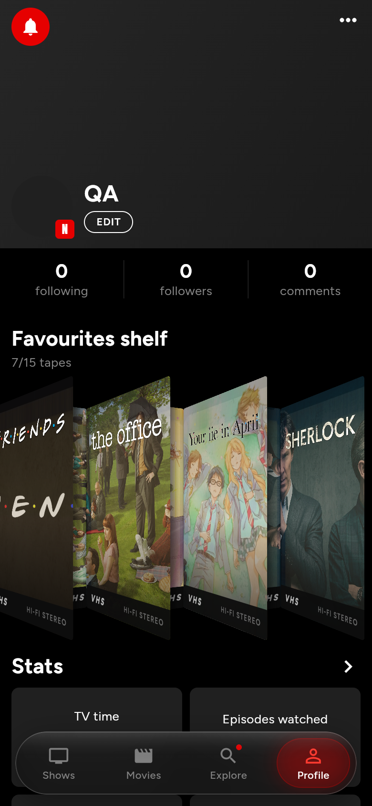
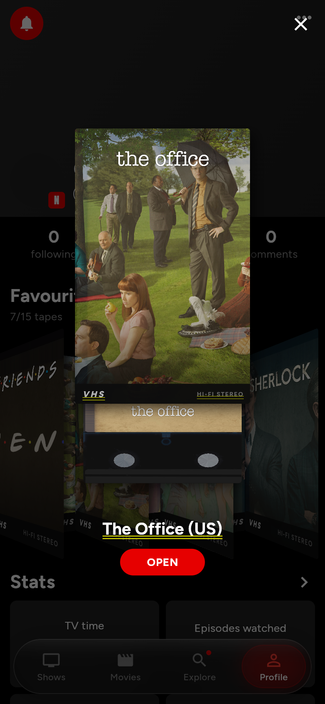

# NextCue shelf remodel — Phase 0 audit and risk report

Status: written before any existing file was changed (2026-10-02).
Scope: everything that draws, loads or feeds the VHS / DVD / shelf experience.

Baseline at audit time: `flutter analyze` → *No issues found*; `flutter test` → **45 / 45 pass**.

---

## 1. Inventory

### 1.1 Code

| File | What it is | Used by |
|---|---|---|
| `lib/widgets/vhs_shelf.dart` | Entire v0 experience: `VhsShelf` (horizontal `ListView`), `_ShelvedVhs` (per-tape `FutureBuilder`), `_Vhs3DBox` (two `Transform.rotateY` planes), `_VhsSpine`, `_VhsFront`, `_ClearLogo`, `_WornImage`, `_VhsEjectDialog`, `_Cassette`, `_CassetteLabelBrand`, `_VhsAtlas` + `_AtlasSprite` + `_AtlasPainter` (crops two rectangles out of a downloaded texture atlas). | `profile_screen.dart` only |
| `lib/screens/profile_screen.dart` | Hosts the "Favourites shelf" header (`n/15 tapes`) and `VhsShelf(ids: favoriteIds)`. | router `/profile` |
| `lib/models/models.dart` → `BrandArt` | `{clearLogo, background}` for the shelf. | repository, shelf |
| `lib/data/repository.dart` → `brandArt()` | Default no-op. | |
| `lib/data/tvdb_repository.dart` → `brandArt()` | TVDB artwork type 23/25 (clear logo) and 3/15 (background/fanart), AniList fallback to banner/poster, in-memory cache. | shelf |
| `lib/state/app_state.dart` | Favourites API: `isFavorite`, `toggleFavorite` (returns `false` when full), `favoriteIds`, `favoriteLimitFree = 15`, `favoriteLimitPremium = 30`. Also everything the new *state language* needs: `statusOf`, `watchedCountFor`, `lastWatchedAt`, `isWatched`, `setWatched`. | title actions, title detail, shelf |
| `lib/widgets/title_actions.dart`, `lib/screens/title_detail_screen.dart` | "Add to favourites" / "Take off the shelf" entry points with the full-shelf snackbar. | app-wide |
| `lib/screens/decide_screen.dart` | Decide wheel (possible integration point, not shelf code). | |

There are **no** shaders, no `FragmentProgram`, no Blender scripts, no GLB loaders, and no DVD widget in the tree. (The July `dvd_shelf.dart` was replaced by `vhs_shelf.dart` in round 4.)

### 1.2 Assets

| Path | Origin | Used? |
|---|---|---|
| `assets/vhs/textures/None_baseColor.png` (2048², 2.2 MB) | Sketchfab "VHS" by Terizmeh, **CC-BY-4.0** | **Yes** — listed in `pubspec.yaml`, sampled by `_VhsAtlas` |
| `assets/vhs/vhs.glb`, `VHS.usdz`, `vhs.zip`, `vhs (1).zip`, `scene(1).gltf/.bin`, other `textures/None_*` | same | no |
| `assets/vhs/death_ship_vhs_box.glb/.usdz/.zip`, `scene.gltf/.bin`, `textures/13729_*` | Sketchfab "Death Ship VHS Box" by 3D_Geek, **CC-BY-4.0** | no |
| `assets/vhs/source/model.zip` | unknown | no |
| `assets/fonts/Anton-Regular.ttf`, `Figtree-*.ttf` | bundled | yes (text) |

Font coverage, checked with fontTools against `ľĽšŠčČťŤžŽýÝáÁíÍéÉúÚôÔäÄňŇďĎĺĹŕŔěĚřŘůŮóÓ„“–—’…·`:
**Anton and all six Figtree weights cover every glyph** — no new font is needed for Slovak/Czech.

### 1.3 Reference material

* `Downloads/ScreenRecording_07-20-2026 05-36-33_1.MP4` (the user's reference, "Stubs" app). Frame analysis: dense row of cases, each turned so the spine plus a sliver of the cover shows; on tap the case **lifts straight up out of the row (~0.4 s), yaws ~90° to face the viewer with a small spring overshoot (~0.5 s), then opens to reveal the media**, background dimmed and blurred.
* `inspiration/IMG_38xx` (July) and `inspiration/IMG_30xx` (August): general app UI references.
* `Prologue.docx` at the workspace root is prose fiction, not a project document.

---

## 2. What is wrong with v0 (evidence: `docs/audit/before-*.png`)

 

**Geometry**
* Each box is two independent `Transform`s with their own perspective, so spine and cover don't share a corner — visible seams and gaps at the top edge.
* Proportions are wrong: cover 132×208 (0.63) vs a real VHS sleeve 104×188 mm (0.55).
* No top/bottom faces, no bevels, no thickness; items overlap and clip each other (the leftmost tape is cut off, "VHS" reads "HS").
* There is no shelf: tapes float on black.

**Materials and lighting**
* No lighting model at all — flat images, no shadow, no AO, no highlight, no ground contact.
* "Wear" is a 30 % multiply of an unrelated region of a downloaded texture atlas, which casts a muddy yellow tint over every poster.

**Label mapping**
* Spine = a 90°-rotated crop of a landscape banner: **no title on the spine**, unreadable art sliver.
* Cover = TVDB *background* fanart (landscape 16:9) forced into a portrait frame — badly composed crops (Friends shows only "E N").
* Cassette label = a stretched, blurry rectangle from the atlas.

**Text fit / UI bugs**
* Long titles are never fitted; the cover fallback just ellipsizes.
* **Eject dialog renders text with Flutter's debug yellow double underline** (no `Material` ancestor in `showGeneralDialog`) — a visible bug in v0.

**Image loading and memory**
* Full-size TVDB backgrounds (≈1920×1080, ~8 MB decoded each) decoded for a 132×208 cover; no `cacheWidth` / `ResizeImage`.
* The 2048² atlas (≈16 MB decoded) is loaded to draw two small regions.
* No loading shimmer; failures fall back to a flat dark box.

**Performance / jank**
* `_ShelvedVhs.build` creates a **new `Future` on every build**, so any `AppState` notification re-runs both repository calls and the `FutureBuilder` flashes back to its empty state.
* Per-tape `Opacity` + multiply blend forces a `saveLayer` per tape.

**Product gaps**
* No state language (not started / watching / completed / new episode).
* One horizontal row only; nothing that scales past ~20 tapes.
* No `Semantics`, no reduced-motion handling, dark-only colours in the dialog.
* **License compliance:** a CC-BY-4.0 texture ships without the required author credit.

---

## 3. What is worth keeping

* **Data layer, unchanged:** `ContentRepository.titleById` (poster, banner, seasons), `ContentRepository.brandArt` + `BrandArt` (clear logo), `TvdbApi`, `AniListApi`, `ApiCache`.
* **State, unchanged:** the whole `AppState` favourites API and limits, plus the watch-state getters the state language needs.
* **Entry points, unchanged:** `title_actions.dart` and `title_detail_screen.dart` favourite toggles and their full-shelf snackbars.
* **Public interface others depend on:** `VhsShelf({required List<String> ids})` is used only by `profile_screen.dart`. The remodel keeps a widget with that constructor so the profile keeps working; everything inside it is replaced.
* **Tests:** all 45 existing tests are independent of the shelf and must keep passing.

Nothing in `vhs_shelf.dart` or `assets/vhs/` is worth keeping.

---

## 4. Tactical risks and mitigations

| # | Risk | Mitigation |
|---|---|---|
| R1 | **Blender not on PATH**; installed **5.2.0 LTS** (target was 5.1.2). | Build entry points locate `blender.exe` (env `BLENDER`, then the default install path). Scripts read `bpy.app.version`, use only APIs stable across 4.x–5.x, and avoid the compositor entirely (pass packing is done with numpy). Version noted in README. |
| R2 | Windows paths with spaces (`Claude Code`, `TV Time`). | `pathlib` everywhere in Python; every path passed after `--` and quoted; PowerShell and bash rebuild commands documented. |
| R3 | `python` on PATH is **Python 2.7**; host Python 3.14 has Pillow but no numpy. | The pipeline runs entirely inside Blender's bundled Python (which ships numpy). Host tooling uses `py` / Node, never `python`. |
| R4 | Cycles render time for turntables and plate sequences. | GPU (RTX 2070 SUPER, OptiX) + OIDN denoise, per-asset sample budgets, a content-hash cache so unchanged assets are not re-rendered, and a `--quick` preview mode. |
| R5 | **`setImageSampler` defaults to `FilterQuality.none`** (nearest). | The compositor always passes an explicit filter quality; data textures are dilated so bilinear filtering never mixes label and non-label UVs. |
| R6 | 8-bit UV precision would stair-step labels larger than 256 px. | UVs are stored as 16-bit across two images (high and low byte). Bilinear filtering stays exact because `256·hi + lo` is linear. |
| R7 | PNG alpha is premultiplied on decode, which would corrupt data stored in alpha. | Data images are opaque RGB; only the beauty plate carries alpha. |
| R8 | **Real-time glTF in Flutter**: `flutter_gpu` ships in this SDK (`bin/cache/pkg/flutter_gpu`) but is experimental, Impeller-only, opt-in per platform, and **has no web backend** — this app ships web. WebView viewers (`<model-viewer>`) are heavy, can't composite with Flutter UI, and have no Windows desktop plugin here. | Use the brief's default: Cycles plates + UV/lighting passes + `FragmentProgram` compositor. GLBs stay committed as the source of truth. No spike was run because the web blocker already rules out "same quality on every platform". |
| R9 | Texture memory on mid-range phones. | Plates sized to their on-screen use (≤2× logical), low-res rotation frames for motion with a high-res swap at rest, an LRU of decoded frames, per-title label atlases bounded by count and bytes, `ui.Image.dispose()` on eviction, remote art decoded with `cacheWidth`. Budgets are documented in the README. |
| R10 | Text layout and texture composition per tape on the UI thread. | Labels are composed lazily for visible tapes only, cached by `(titleId, state-hash)`, and rasterised with `Picture.toImage` (raster thread). |
| R11 | Fragment shaders: no HTML renderer (removed upstream), subset of GLSL. | CanvasKit/Skwasm (web), Impeller (iOS/Android) and Skia (older Android) all support `FragmentProgram`; the shader avoids dynamic loops and uses named uniforms. A non-shader fallback paints the plate alone. |
| R12 | **No git repository and no git identity.** | `git init` in `showtrack-app/`, repo-local identity, `.gitignore` for build output, the third-party `assets/vhs/` downloads, `inspiration/` screenshots and golden failure artefacts. A secret scan found none: the TVDB key only arrives through `--dart-define`, Firebase is a placeholder. |
| R13 | Destructive steps. | The third-party files in `assets/vhs/` are **not deleted** — only unlisted from `pubspec.yaml` and left untracked; deleting them is left to the user. No dependency upgrades are planned. |
| R14 | Android toolchain warnings (cmdline-tools missing, license status unknown); no Visual Studio, so no Windows desktop build. | Benchmark on the `medium_phone` emulator if the APK build succeeds; otherwise a release web build in Chrome with frame timing. Whatever is measured is reported as-is. |
| R15 | Emulator frame times are not a real mid-range phone (host GPU). | Profile-mode builds, raster and UI thread times reported separately, plus the CPU-side cost per tape, so the numbers can be read honestly. |
| R16 | Image generation for photographic textures. | No image-generation tool is available in this environment, so the pipeline is **fully procedural** (0 generated images). |
| R17 | Bundle size growth from plates. | WebP for beauty plates, PNG for data, cropped to content; a hard budget in the README. |

---

## 5. Rendering strategy decision

**Chosen: pre-rendered Cycles plates + UV and lighting passes, composited per pixel by a Flutter fragment shader.**

* Every view (shelf poses, the rotation sequence, front hero, cassette) is rendered in Blender with three images:
  * `*_color` — RGBA beauty. Label surfaces are rendered **black** with their gloss coat, so `C` carries the specular highlight and every non-label pixel.
  * `*_uv` — `R` = U high byte, `G` = V high byte, `B` = `D`, the anti-aliased diffuse lighting of a white label (black everywhere else).
  * `*_uv2` — `R` = U low byte, `G` = V low byte, `B` reserved.
* At runtime each tape has one **label atlas** `T` (spine, front, back, cassette label) composed by Flutter from the poster, logo, fitted title and state stickers. The shader computes `out = C + T(uv) · D`, which is exact on anti-aliased edges because coverage is already folded into `D`.
* Same pixels on Impeller, Skia and CanvasKit; no 3D engine at runtime.

**Real-time GLB was not adopted.** The brief allowed it only if proven at
60 fps on a mid-range Android at equal quality. It fails on quality before
performance matters:
* `flutter_gpu` has no web backend, so real-time 3D would need a second
  renderer for the web build.
* What makes the plates photographic is path-traced: area-light soft
  shadows, contact shadows between packed tapes, laminate reflections of
  room-sized softboxes, and inter-reflection inside the shelf bays.
  A mobile rasteriser approximates these with shadow maps and a single
  environment map, visibly worse at shelf scale.
* A 100-tape shelf in real time is 100 × 50k faces (5M) or LOD meshes. With
  plates it is 12 shader quads per bay, composed once into a cached image.

The GLBs are still built and committed (`assets/3d/`) as portable assets
with baked PBR textures, and the build re-imports them to prove the bake.

As built (2026-10-02): 13 shelf plates (0.44 MB) and 42 hero plates
(5.1 MB: 36 rotation frames, 2× front, 5 cassette progress levels). The UV
precision is 16-bit on the shelf and 13-bit on the hero. The contract is in
`docs/PLATES.md`.

Benchmark numbers are appended to §6 once measured.

---

## 6. Benchmarks

### 6.1 Scrolling a 100-tape shelf (2026-10-03)

`integration_test/shelf_benchmark_test.dart`: real `ShelfRenderer`, label
composer and plate shader. 100 tapes in three sections (10 watching,
30 not started, 60 completed), and 12 flings down then 12 up per pass.
Profile build, measured with `FrameTimingSummarizer`:

```bash
flutter drive --profile --no-dds --driver=test_driver/perf_driver.dart --target=integration_test/shelf_benchmark_test.dart -d emulator-5554
```

Device: Android emulator `medium_phone` (x86_64, GLES through the host's
RTX 2070 SUPER, `ro.hardware.egl=emulation`), Impeller.

| Pass | UI avg / p90 / p99 (ms) | Raster avg / p90 / p99 (ms) | Frames | Over 16.7 ms raster |
|---|---|---|---|---|
| Shelf, cold (rows compose while scrolling) | 5.0 / 10.0 / 24.6 | 33.0 / 50.9 / 106.7 | 666 | 646 |
| Shelf, warm (cached rows) | 4.8 / 9.0 / 22.7 | 31.2 / 48.0 / 83.9 | 712 | 686 |
| **Control**: plain list of 12 bay-size images, no shelf code | 3.9 / 7.5 / 15.3 | 29.5 / 45.0 / 79.8 | 729 | 693 |

Reading:
* **The UI thread fits 60 fps**: 5 ms on average, 9–10 ms at p90.
* **The raster thread does not reach 60 fps on this emulator, but neither
  does a plain image list.** The control, with no shelf code at all, costs
  29.5 ms per frame, so the emulator's translated GLES is the bottleneck.
  Over the control, the shelf adds **+1.7 ms per frame warm and +3.4 ms
  cold** (the row composition).
* The same run with Skia (`--no-enable-impeller`) hung during app start on
  this emulator and produced no numbers.
* **Not met / not measured:** 60 fps on a real mid-range Android phone. No
  physical device was available, so the brief's acceptance number
  is unproven. Given the control, the shelf's own share is small, but this
  needs a run on hardware with the command above.

### 6.2 Composition cost

* Label atlas in `flutter_tester` (software raster, an upper bound):
  * shelf spine (224 px): ~19 ms
  * hero atlas (1536 px): ~120 ms
  * recording only: 1 ms and 2.5 ms
* Both run off the scroll path. A row's labels are composed once into a
  cached row image, and the inspect view composes its hero atlas while
  the tape lifts out.

### 6.3 Texture memory (documented on `PlateImageCache`)

* **Browsing: about 65 MB.**
  * shelf plates: 21.4 MB, resident
  * composed rows: up to 28 MiB
  * spine art: up to 12 MiB
  * rail cards: up to 3 MiB
* **The inspect view adds about 45 MB while open**, all freed on close:
  * hero atlas: 9.4 MB
  * up to 10 composited frames: 24 MiB
  * `front_hi`: 9.2 MB
  * cassette: 2.2 MB
  * a frame's sources are dropped right after it is composited
* Web (CanvasKit, release build, demo account):
  * heap with the collection open: 33.5 MB
  * peak with the inspect view open: 134 MB, flat across repeated full turns
